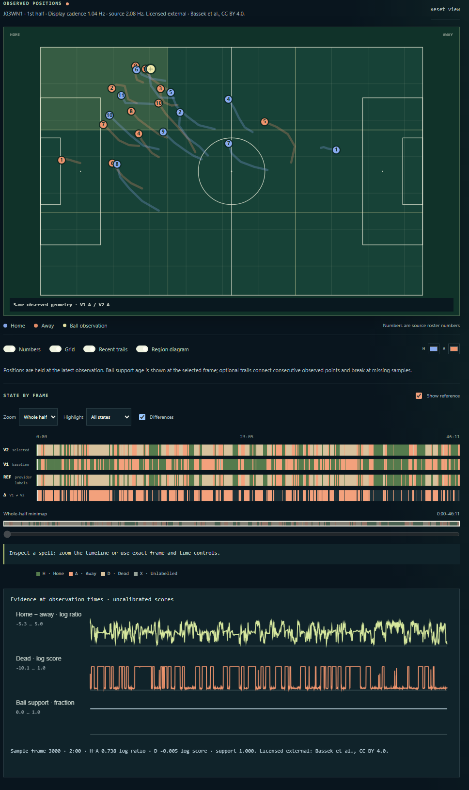
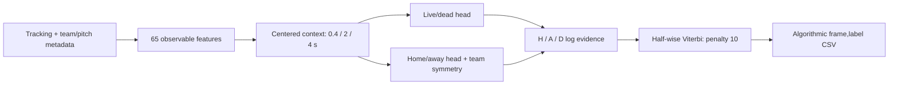
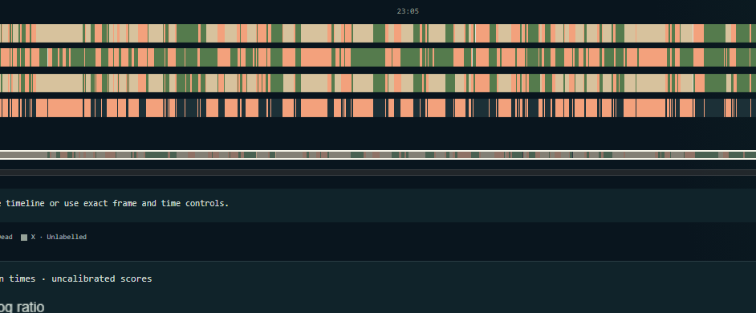
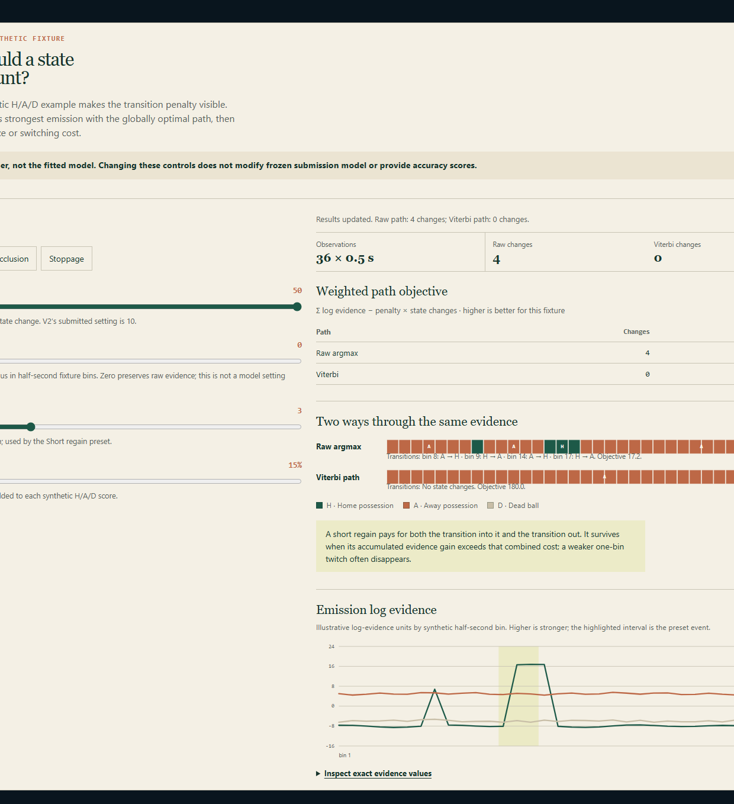

<div align="center">

# Malwarous

### Read possession through the gaps.

An offline football possession engine with observable context, persistent sequence decoding, and an inspectable match replay.

**Muhammad Hasnaat Hussain · Kabir Niazi · Younus Rehmatullah**


**[Open interactive Atlas →](https://malwarous-atlas.vercel.app)** · [Technical PDF](submission/Malwarous.pdf) · [Repository guide](docs/REPOSITORY_MAP.md)

[](https://malwarous-atlas.vercel.app/#replay)

<sub>Licensed external replay: Bassek, Rein, Weber & Memmert, CC BY 4.0. Positions thinned for display; state intervals retain full frame support. No competition-match imagery.</sub>

</div>

## At a glance

The frozen submission is **`context_p10_r0`**. It produces H / A / D / X labels from tactical tracking, treats missing observations as missing evidence, and decodes each half independently. It uses future context and runs offline.

Atlas lets you play six licensed matches, compare V1/V2 timelines, zoom into spells, inspect observation support and evidence, and explore a synthetic decoder. It replays saved development outputs; it is not live model inference. The squad cards introduce our community through a football metaphor.

## Method



No match ID, player identity or absolute match-time feature enters the model. A fixed switching cost suppresses weak flicker without imposing a hard minimum possession length. The target adapter supplies the official frame/half contract; it does not prescribe possession labels.

## External development evidence

**Six reused external matches, three whole-match excluded folds, three observation scenarios, 18 paired rows. These are selection-conditioned development measurements, not independent validation or competition scores.**

| Method | Mean spellF1 | Mean macroF1 |
|---|---:|---:|
| V1 smooth50 reference | 0.25548 | 0.39809 |
| Frozen V2 `context_p10_r0` | **0.48095** | **0.86868** |

The reference is our matched smooth50 implementation; this table does not compare against every organizer baseline. The all-six fitted artifact's J03WMX check (0.5240 / 0.9185) is descriptive: that match was previously consumed in a V1 audit. [Full evidence](docs/FINAL_SUMMARY.md).

The registered V6 transition study re-examined existing penalties on the same 18 external rows. Penalties 25 and 50 both failed the replacement gate; p10 remains shipped. Smart Tagging fusion was not promoted without adequate external timing/independence evidence. [All V6 rows and losses](docs/experiments/V6_RESULTS.md).

<details>
<summary>Inspect the evidence and the synthetic decoder</summary>

[](https://malwarous-atlas.vercel.app/#replay)

*Licensed external observations: Bassek et al., CC BY 4.0. Raw log evidence is uncalibrated; it is not confidence.*

[](https://malwarous-atlas.vercel.app/#decoder-lab)

*Synthetic software fixture. Lab controls illustrate a decoder; they do not change fitted weights or establish accuracy.*

</details>

## Reproduce

Use **64-bit CPython 3.11.9**. Put the separately authorized competition bundle outside Git, then run these four commands from the repository root on Linux/macOS:

```sh
python3.11 -m venv .venv
.venv/bin/python -m pip install -r requirements.lock
MTAH_DATA_DIR='/path/to/authorized/bundle' .venv/bin/python -m malwarous.v2.safe_runner v2_target_infer
MTAH_DATA_DIR='/path/to/authorized/bundle' .venv/bin/python -m malwarous.v2.safe_runner v2_target_reproduce
```

Check each command succeeds before advancing. No training/finalizer step is needed. The output is `artifacts_private/v2/Malwarous-v2.csv`; the second command independently regenerates it and requires byte identity. Linux/WSL CPython 3.11.9 with the lock reproduced the published CSV byte for byte, as did the Windows release environment. This is reproduction evidence, not accuracy evidence.

<details>
<summary>Windows PowerShell, local demos and verification</summary>

```powershell
python -m venv .venv
.\.venv\Scripts\python.exe -m pip install -r requirements.lock
$env:MTAH_DATA_DIR='D:\path\to\authorized\bundle'
.\.venv\Scripts\python.exe -m malwarous.v2.safe_runner v2_target_infer
.\.venv\Scripts\python.exe -m malwarous.v2.safe_runner v2_target_reproduce
```

Public Atlas preview: `python -B scripts/serve_public_site.py --port 8788` (no dependencies), then open http://127.0.0.1:8788. Local analysis workbench: `python -m workbench.server --port 8765`. Its default demonstration is synthetic.

Source integrity: `python -B scripts/verify_repository.py`. Tests: install `requirements-test.in`, then `python -m pytest -q`. Decoder checks: `node --test scripts/test_decoder_lab.mjs`.

</details>

## Assets used and not integrated

| Asset | Selected pipeline |
|---|---|
| Tactical ATD and its metadata | Used: positions, anonymous team membership, pitch geometry |
| Official match constants | Used: frame count and separate half blocks |
| External DFL/Sportec tracking + provider labels | Used: fitting and grouped development; CC BY 4.0 |
| Smart Tagging | Not integrated. Public loader reviewed; restart windows are approximate, not exact D spans. External fusion qualification failed. |
| Homography | Not integrated: the selected method consumes already projected pitch coordinates. |
| Broadcast video / ATD | Not integrated: separate timeline; no validated automatic alignment or fusion. |
| Tactical video | Not an inference input to selected V2. Human local viewing does not supply labels. |

“Not integrated” does not imply a completed benchmark or an unsuccessful implementation. No target human annotation, public-window tuning or frame-specific possession correction is used. [Technical note](docs/TECHNICAL_NOTE.md).

## Find your way

[Repository map](docs/REPOSITORY_MAP.md) is the authoritative guide. [Frozen dependency ledger](docs/FROZEN_DEPENDENCIES.md) explains why older-named files remain. They are hash-locked reproduction dependencies, not additional submission choices. [Team comparison](docs/TEAM_COMPARISON.md) describes a fair external comparison of teammates' methods.

## Limits

Short possessions remain difficult. Provider-label semantics, synthetic dropout realism and transfer to automatic tracking limit generalization. All external matches have been consumed; no fresh independent dense-label test qualified. No defensible full-match target-score range or competition rank is available. Source/model checks and passing tests do not prove accuracy or eliminate every security risk.

## Submit

| Form field | Team deliverable |
|---|---|
| Team | Malwarous; three registered technical members |
| Possession file | [Malwarous.csv](submission/Malwarous.csv) |
| Technical document | [Malwarous.pdf](submission/Malwarous.pdf), source [docs/Malwarous.html](docs/Malwarous.html) |
| Public source | This repository |

Validate the exact upload with `python evaluation/validate_submission.py submission/Malwarous.csv` and check its SHA-256 against `SOURCE_MANIFEST.json`. Publishing here does not submit the organizer form. [Release ledger and checklist](docs/CONTINUATION_LEDGER.md).

## Attribution

Code retains the organizer MIT notice in [LICENSE](LICENSE). External data and derived weights/results credit **Manuel Bassek, Robert Rein, Hendrik Weber and Daniel Memmert**, *An integrated dataset of spatiotemporal and event data in elite soccer*, [Figshare v1](https://doi.org/10.6084/m9.figshare.28196177.v1), CC BY 4.0; transformations are described in [MODEL_ATTRIBUTION.md](MODEL_ATTRIBUTION.md) and [public replay provenance](website/PUBLIC_DATA.md). Authors do not endorse this model. Competition assets have separate restricted terms and are excluded.
