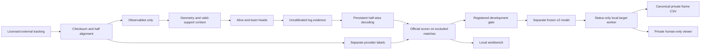

# Possession workbench and v2 engine

## What this implementation does

V2 treats possession as a persistent state inferred from imperfect observations. It separates alive/dead evidence from team control, retains the age and support of real observations, and decodes the complete half as an offline sequence. Missing ball observations do not automatically become dead ball. It does not use track slots as identities, target labels, manually annotated target boundaries, target-match event knowledge or competitor implementation.



The input contract for `build_context` is one continuous half, metres, pitch-centred origin. The competition parser returns corner-origin metric arrays, so the reviewed adapter subtracts half the pitch dimensions. Sportec is already centred. No feature receives labels, match ID, frame ID or absolute match time.

The 65 features include instantaneous geometry, observation support, motion support, pitch-edge distance, observed-only context over total widths 0.4/2/4 seconds, and bounded previous/next geometric near-control observations. Zero support is explicit; sentinel missing distances are excluded from weighted averages. The nearby-control observations are derived from ball/player geometry, never source labels. Future context and Viterbi decoding make this an **offline** method. None of its probability or evidence values is asserted to be calibrated confidence.

Two shallow histogram gradient boosting heads use natural alive/dead priors and team-swap augmentation. Team swapping is also averaged at inference, so H/A evidence is equivariant. The original weak per-frame transition cost is a diagnostic ablation; six registered candidates vary stronger switch cost and short evidence averaging. There is no hard minimum spell duration that would categorically erase a short strong possession.

## Evidence and limitations

Read `experiments/V2_STUDY.md` before interpreting results. The six DFL matches were already consumed in v1. Three whole-match folds prevent fitting on the particular evaluation match, but pooled candidate selection is still development. The selected cross-validation score is selection-conditioned, not a new blind test or a competition-target score. The current external provider labels and synthetic dropout do not establish equivalence to the competition's inherited-control semantics or vision-tracker errors.

The official scorer remains unchanged. The campaign reports all candidates on every match/scenario, spellF1 first, macroF1, class/transition diagnostics, H/A spell counts and runtime provenance. Match-clustered bootstrap intervals describe variation across six matches after selection; they do not remove selection bias. The stronger-persistence method must clear a registered gain and per-match regression gate before the finalizer will produce a separate v2 artifact. A failed gate preserves the v1 recommendation.

See `experiments/V2_DIAGNOSIS.md` for v1 fragmentation evidence and `experiments/V2_DATA_REVIEW.md` for exact sources, licence/access decisions and rejected dense-label assumptions. DFL/Sportec data is CC BY 4.0, released at https://doi.org/10.6084/m9.figshare.28196177. No additional video detector is credited with possession improvement without measurement.

## Local commands

From the repository root, use the pinned environment. The frozen review distribution includes the checksum-verified external-only fitted model and config; it needs no training or finalizer step. Use the status-only inference commands below for that distribution. The following campaign commands are for the original development checkout and its licensed external cache; do not run a second campaign while its process is live.

```powershell
.\.venv\Scripts\python.exe -m pytest -q
.\.venv\Scripts\python.exe -u -m malwarous.v2.study
.\.venv\Scripts\python.exe -m malwarous.v2.report
.\.venv\Scripts\python.exe -m malwarous.v2.reproduce --fold 0
.\.venv\Scripts\python.exe -m malwarous.v2.export --matches J03WN1 --scenario original
.\.venv\Scripts\python.exe -m workbench.server --data artifacts_private/v2/workbench-external.json
```

The campaign refuses changed source/config fingerprints and records checkpoints under ignored `artifacts_private/v2`. Its eight-hour wall-clock budget includes resumed attempts. Do not delete locks to restart a possibly live job; inspect the process/session. `v2-results.json` is licensed external benchmark evidence. Cached arrays, other fitted artifacts and logs stay ignored. The development protocols are preserved to explain selection; reproducing the selected submission uses the included frozen weights, not another campaign.

For the original development checkout only, `malwarous.v2.finalize` creates a new external-only model after a complete passing report. It deliberately refuses an existing config or model. Do not use it as setup for the frozen distribution. With the included frozen weights and reviewed adapter, run:

```powershell
$env:MTAH_DATA_DIR='D:\path\to\authorized\mtah2027-bundle'
.\.venv\Scripts\python.exe -m malwarous.v2.safe_runner v2_target_infer
.\.venv\Scripts\python.exe -m malwarous.v2.safe_runner v2_target_reproduce
.\.venv\Scripts\python.exe -m malwarous.v2.safe_runner v2_local_viewer_export
```

Each safe-runner command returns fixed checks only; inspect its exit status before advancing. Target output is separately named `artifacts_private/v2/Malwarous-v2.csv`. It never replaces v1's CSV/config/source lock or the prepared v1 release snapshot. The optional local viewer bundle has predictions, observation quality and evidence, **empty truth and benchmark arrays**, and the tactical MP4 with its documented exact clock. Broadcast is a separate timeline; no unverified synchronization is invented.

The restricted viewer is for the human operator locally. Do not capture it with hosted browser/image tools, paste its values/logs into a model, or publish its files. The browser QA script explicitly refuses `private_local` bundles. The Python socket guard is a reviewed application-level boundary, not an OS firewall.

## Public-safe demonstration

```powershell
.\.venv\Scripts\python.exe -m workbench.make_demo_video
.\.venv\Scripts\python.exe -m workbench.server --data artifacts_private/v2/demo/demo.json --media-map artifacts_private/v2/demo/media-map.json --port 8766
node scripts/check_workbench_browser.mjs http://127.0.0.1:8766
```

Generation refuses to overwrite an existing synthetic video; once generated, use the server command directly. The 72-second generated animation shares exact fixture positions with the pitch renderer. Its authored labels exercise inspection; its metric cells are null, with an explicit software-demo label. Licensed external results are a separate evidence type. The loopback server uses an explicit media allowlist, no remote requests or telemetry, Range serving and strict Host/path checks. It is a single-user local application.

The interface supports synchronized play/seek/speed, both prediction timelines, missing-observation indicators, actual supplied evidence, labelled-match disagreement/boundary navigation and per-match benchmark provenance. Pitch rendering is thinned while labels remain full-rate; the latest observation timestamp and age are displayed. Half-view benchmark scores retain their declared **whole-match** scope. Boundary offsets in the UI are descriptive and distinct from official scorer matching.

## Final release clarification

The selected candidate remains `context_p10_r0`; V6 transition diagnostics did not promote p25 or p50. See `experiments/V6_RESULTS.md` for all18 matched rows per candidate and losses. Smart Tagging/homography/broadcast are not integrated in this selected pipeline. Linux/WSL CPython3.11.9 with the pinned environment reproduced the published CSV exactly. The final CSV/PDF in `submission/` are explicitly team-published outputs; raw assets and private viewers remain excluded.
